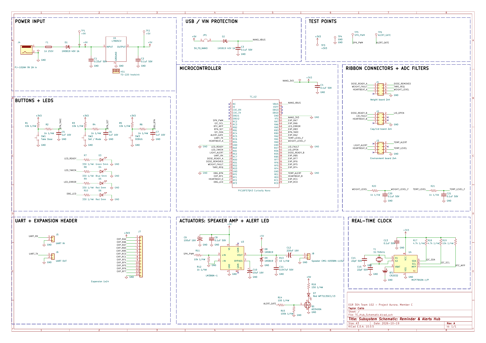

# Schematic

## Overview

This schematic is for my Reminder & Alerts hub board (Team 102, Project Aurora). It keeps the dose schedule with an MCP7940N real-time clock and alerts the user with an LM386 speaker amplifier and a bright red alert LED switched by an AO3400A MOSFET. Power comes from a 9 V wall adapter through a barrel jack, a 1 A fuse and a reverse-polarity diode into an L7805CV regulator, which makes the 5 V rail. The PIC18F57Q43 Curiosity Nano is the controller and also supplies the 3.3 V rail. It talks to the Weight, Cap/Lid and Environment boards over three 2x4 ribbon connectors (pin 8 = GND), and has debounced buttons, status and debug LEDs, UART headers, an expansion header and test points for debugging.

**Figure 1:** Subsystem schematic for the Reminder & Alerts hub board. Click the image to enlarge it.

## Resources

The schematic as a PDF download is available [here](TC_Hub_Schematic.pdf), and the Zip folder of the project [here](TC_Hub_Schematic.zip).
