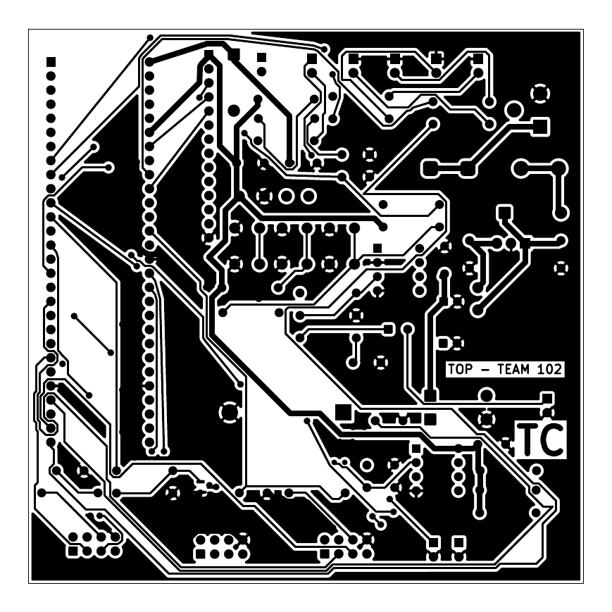
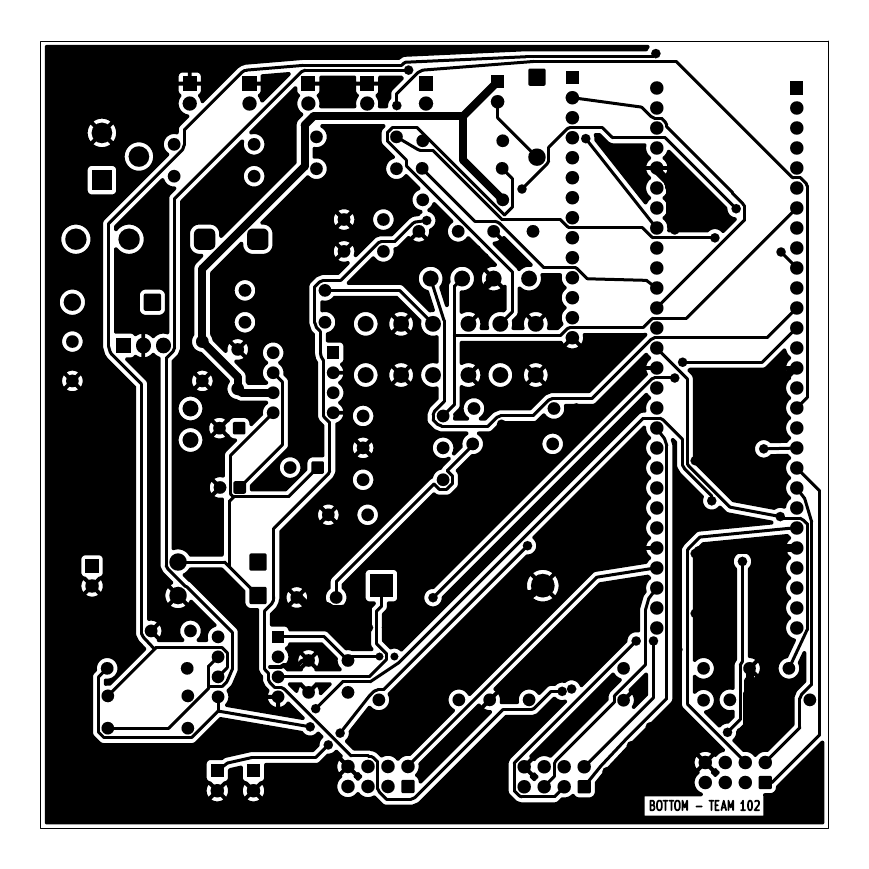

# PCB Design

## Overview

This is the printed circuit board layout for my Reminder & Alerts hub board (Team 102, Project Aurora), designed in KiCad from the updated schematic. The board is 2 layers (top and bottom copper), 100 mm x 100 mm, with a ground pour on both sides. Custom footprints are in my `TC_Footprints` library and my initials are on the top copper layer. The design passes KiCad's Design Rules Check with 0 errors and was pre-checked for manufacturing with the JLCDFM online DFM tool.

## Top Layer

**Figure 1:** Top (front) copper layer of the hub PCB. Click the image to enlarge it.

## Bottom Layer

**Figure 2:** Bottom (back) copper layer of the hub PCB. Click the image to enlarge it.

## Resources

- PCB layout (top and bottom) as a PDF: [TC_Hub_PCB_Layout.pdf](TC_Hub_PCB_Layout.pdf)
- KiCad project, including custom symbol and footprint libraries: [TC_Hub_KiCad_Project.zip](TC_Hub_KiCad_Project.zip)
- Gerber and drill files for manufacturing: [TC_Hub_Gerbers.zip](TC_Hub_Gerbers.zip)
